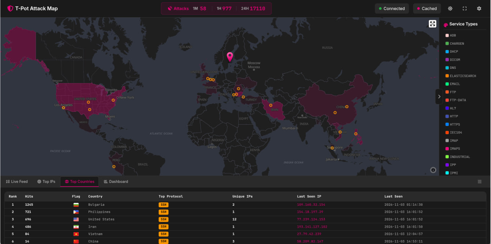
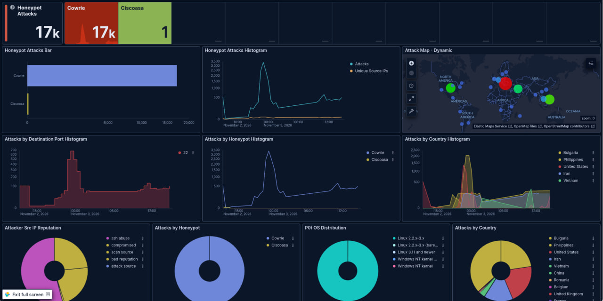
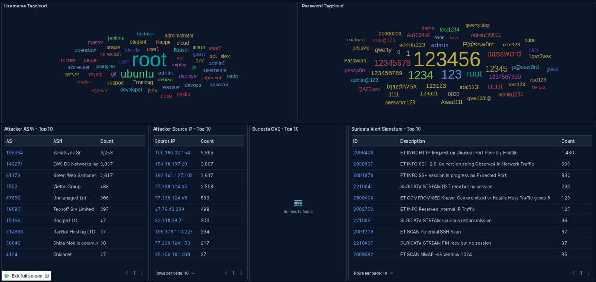

# 🛡️ Azure Cloud SOC Honeypot & Threat Intelligence (T-Pot CE)

## 📌 Project Overview
Deployed a multi-honeypot framework (**T-Pot CE**) in Microsoft Azure to capture, analyze, and generate threat intelligence on real-world attacks. Collected and analyzed over **17,000+ incident events** within a 24-hour telemetry window.

## 🏗️ Architecture & Stack
* **Cloud Infrastructure:** Microsoft Azure (Debian 13, Standard_B2s_v2)
* **Framework:** T-Pot CE (Cowrie, Suricata, Nginx, Elastic Stack)
* **SIEM & Analytics:** Kibana, ElasticSearch
* **Threat Intel & OSINT:** AbuseIPDB, VirusTotal

---

## 📊 Key Threat Intelligence Findings

| Metric | Value / Detail |
| :--- | :--- |
| **Total Captured Events** | **17,103 attacks** |
| **Primary Vector** | SSH (Port 22 via Cowrie Honeypot) |
| **Top Origin Countries** | Bulgaria (1,245), Philippines (685), USA (677) |
| **Top Attacker IP** | `109.160.32.154` (5,995 attempts) |
| **Targeted Vulnerability** | **CVE-2024-6387** (regreSSHion RCE attempt) |
| **Top Credentials Tried** | User: `root`, `ubuntu` | Pass: `123456`, `password` |

---

## 🖼️ Visualizations & Dashboards

### 1. Live Attack Map

### 2. Kibana SIEM Dashboard & Credential Brute-Force Analysis

---

## 📑 Deliverables
* 📄 **[Full Threat Intelligence Report (PDF)](./tpot_threat_intel_report.pdf)** — Detailed analysis including MITRE ATT&CK mapping, IoCs, and SOC mitigation strategies.
* 🎥 **[3-Minute Demo Video](https://youtu.be/4LXfOZwiQqo)** — Walkthrough of the live framework, telemetry, and OSINT analysis.

---
**Author:** Yevhenii Shevchenko (Shebysho) — Aspiring SOC Analyst  
**Contact:** [LinkedIn Profile](https://www.linkedin.com/in/yevheniy-shevchenko/) | GitHub: `@Shebysho`
